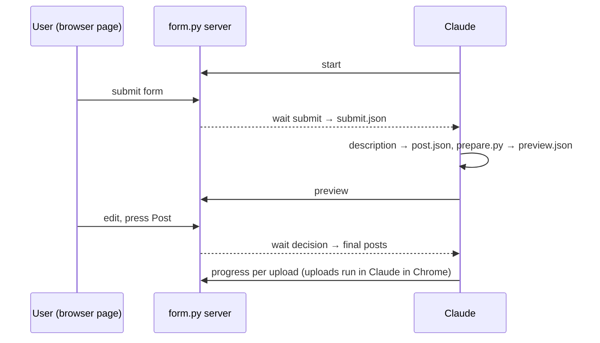

# post-video
The user picks videos, SRT files and a description on a local page, checks every upload's final text on the same page, and presses Post; Claude then uploads through the user's Chrome. Shipped: v0.1.0.

## Components
| Component | File(s) | Role |
|---|---|---|
| Skill | `skills/post-video/SKILL.md` | The steps Claude follows; how messy text becomes `post.json` |
| Form server + CLI | `skills/post-video/scripts/form.py` | Local page on 127.0.0.1 (random port, one-time token); `start`, `wait submit`, `preview`, `wait decision`, `progress`, `done`, `stop` |
| Page | `skills/post-video/scripts/form.html` | Three screens: Files, Check, Post |
| Prepare | `skills/post-video/scripts/prepare.py` | Form + `post.json` → one entry per upload, with warnings |
| Text builder | `skills/post-video/scripts/build_post.py` | Per-platform limits, hashtags, YouTube tags, per-variant overrides |
| SRT cleaner | `skills/post-video/scripts/check_srt.py` | UTF-8, numbering, time format, order; Facebook's `name.<locale>.srt` copy |
| Attach helper | `skills/post-video/scripts/attach.py`, `references/attach.md` | Gets a file of any size into a site's file input: parts under 10 MB go through the browser tool, the page joins and verifies them (SHA-256) |
| Folder scan | `skills/post-video/scripts/scan.py` | Finds videos (by shape), SRT, thumbnails and the description file in a folder → `prefill.json` for `form.py start --prefill`; unsure choices become hints on the form |
| Structure parser | `skills/post-video/scripts/parse_post.py` | Reads a description file in the documented structure into `post.json` word for word |
| Structure spec | `skills/description-file/SKILL.md` | The structure, written for AIs that generate the file; its example and heading list are parsed in the tests |
| Site steps | `skills/post-video/references/*.md` | Where to click on each platform's upload page |

How they talk:

State for one run is in `~/.video-poster/current/`. `~/.video-poster/last_form.json` remembers the dropdown choices, visibility and language.

Dropping a file on the page: a browser tells a page only the file's name, size and date, never its folder. `/api/locate` finds the path from those (folders of files already chosen, then Spotlight, then a shallow walk of the usual folders). A small text file that cannot be found is copied into the run folder (`/api/drop`).

## Rules that must not break
- Nothing is published before the user presses Post on the Check screen; Claude uploads exactly what `wait decision` returns.
- The server accepts requests only with its token and a local Host header, and re-checks length limits on Post.

## Tests and evidence
- Unit: `tests/test_text.py`, `tests/test_attach.py`, `tests/test_structure.py`. End to end (real server and CLI over HTTP): `tests/test_form_e2e.py`. How to run: [harness](../harness/README.md).

## Refine on the Check screen
The user writes an instruction and presses Apply with Claude. The server saves the posts as they are on the page (with the user's own edits) to `refine.json`, switches the page to "applying", and `wait decision` returns `{action: refine, instruction, file}`. Claude changes field values in that file and pushes it back with `form.py preview`. Nothing is posted by a refine; Post still re-checks the limits.

## Thumbnails
`videos.<shape>.thumbnail` on the form → `thumbnail` on each upload. YouTube Shorts take none on the web (shown as skipped). A missing thumbnail option on a site never blocks the post.

## First comment
`post.json` → `first_comment` (per-platform overrides allowed) becomes an optional field on every upload. After an upload is published Claude adds it as a comment and pins it where possible; a failed comment does not fail the upload.

## Attaching files
The browser tool's own file attach takes at most 10 MB per call and only files in the session's folders. `attach.py split` writes parts of 8 MB into `.video-poster-parts/` in the session folder; a temporary file input on the page collects them; `finish_js` builds one `File`, checks size and SHA-256, and sets it on the site's input (or drops it on a drop zone). No network request leaves the page, so a site's content security policy does not block it. Checked by hand on 2026-11-11 with a 21 MB video on a tiktok.com page.

## Known limits
- Attaching was proven on a page with a plain file input; each site's real upload input is still unproven.
- The uploads in Chrome are not tested automatically.
- TikTok's web upload takes no SRT; Facebook Reels often offer only auto captions.
- Native file picker on macOS only.
- A dropped video that Spotlight does not index (external or excluded folders) cannot be located: use Choose or paste the path.
